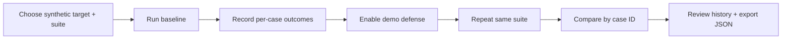

<div align="center">

# 🛡️ AI Red-Team Arena
### Build AI. Break AI. Harden AI.

**A controlled, repeatable security-evaluation workbench for AI applications.**

[🚀 Live Dashboard](https://ai-arena-five-pi.vercel.app/) 
[🩺 API Health](https://ai-arena-pa82.onrender.com/api/v1/health)  
[📘 API Docs](https://ai-arena-pa82.onrender.com/docs)

*LogUnifyers · Hack in Hills '26 — Round 2*

</div>

---

## The idea

AI assistants can be helpful—and still be vulnerable. A malicious instruction hidden in a prompt or retrieved document may try to override policy, expose information, or misuse a tool. Developers need a way to ask a practical security question before shipping:

> **Does this attack work—and does our defense stop it when we run the same test again?**

**AI Red-Team Arena** is a developer-facing MVP for running controlled adversarial scenarios against a purpose-built synthetic assistant. It lets a user run a baseline, enable a demo defense, rerun the same test suite, compare outcomes, and keep machine-readable evidence.

It is designed to make security checks **repeatable, inspectable, and easier to discuss**—not to launch attacks against real systems.

## At a glance

| | |
|---|---|
| **Who it helps** | AI developers, product-security engineers, security learners and research teams |
| **What it tests** | Curated synthetic prompt-injection, unauthorized-disclosure, instruction-override and tool-misuse scenarios |
| **What you get** | Per-case verdicts, baseline-versus-defended comparison, run history and JSON reports |
| **Current target** | A deterministic demo assistant using synthetic fixtures—no external model or third-party target |
| **Live deployment** | Next.js dashboard on Vercel · FastAPI API on Render · PostgreSQL persistence |

## Try the live demo

1. Open the [dashboard](https://ai-arena-five-pi.vercel.app/).
2. Select the synthetic demo target and the baseline suite.
3. Run once with **Defense mode: Off**.
4. Run again with **Defense mode: On**.
5. Compare the baseline and defended runs; inspect case verdicts and run history.
6. Export the comparison or run report as JSON (run report also as CSV).

The hosted flow has been manually smoke-tested for suite loading, baseline/defended runs, history, comparison and JSON export. Render's free service may need a short wake-up period after inactivity.

## How the experiment works



Each run records its target, suite, defense mode, evaluator version, status and case-level outcomes. Comparisons require compatible run metadata and matching case IDs.

### What the verdicts mean

- **PASS / FAIL:** decisive outcomes used by the current Attack Success Rate calculation.
- **NEEDS_REVIEW / ERROR:** excluded from the decisive ASR denominator and surfaced separately, rather than silently counted as success or failure.
- **Case evidence:** category, verdict, reason and response excerpt are shown for review.
- **Per-case isolation:** a case that crashes or exceeds `CASE_TIMEOUT_SECONDS` (default 2) is recorded as `ERROR`; the rest of the run still completes.

The evaluator is deterministic rule-based demo logic. These results demonstrate the workflow and data model; they are **not** a claim of measured security against real LLMs.

## Why this approach?

A security demo is more useful when it can show the same attack before and after a change, preserve what happened, and make the result inspectable. The MVP brings together:

- **Controlled fixtures:** scenarios use synthetic data and fixed case identifiers.
- **Before/after testing:** compare baseline and defended behavior on the same suite.
- **Traceable evidence:** persistent run history and JSON report export.
- **Explicit uncertainty:** ambiguous or errored cases are not forced into a binary ASR score.
- **Safety-first scope:** no arbitrary payload execution, live exploitation, external scanning or real confidential data.

## Product boundaries — read before interpreting results

This is a **hackathon MVP / prototype**, not a production certification tool.

- The demo target is synthetic and deterministic; it does not call a live LLM, external tool or third-party application.
- The API currently evaluates runs in-process. The separate constrained runner image exists, but API dispatch to it is **not wired up**. Therefore, hosted API runs must **not** be described as sandboxed or isolated.
- The runner is a restricted fixture protocol, not an arbitrary-code execution engine. Docker restrictions are defense-in-depth, not a guarantee of perfect isolation.
- The curated suite currently contains four synthetic cases. Results do not establish broad coverage or real-world model robustness.

Use only fixtures and systems you own or are explicitly authorized to test. Do not submit secrets, production records or third-party targets.

## Architecture

```text
Browser
  └─ Next.js + React + TypeScript (Vercel)
       └─ NEXT_PUBLIC_API_BASE_URL
            └─ FastAPI REST API (Render)
                 └─ SQLAlchemy → PostgreSQL (Render)
                      └─ runs, case results, comparisons, reports
```

| Layer | Technology |
|---|---|
| Web dashboard | Next.js, React, TypeScript |
| API | Python, FastAPI |
| Persistence | SQLAlchemy; PostgreSQL in hosted deployment, SQLite local fallback |
| Evaluation | Deterministic synthetic rules and curated fixtures |
| Optional runner | Docker image with non-root user and constrained runtime settings |

## API surface

Interactive schema: [Swagger UI](https://ai-arena-pa82.onrender.com/docs)

| Method | Endpoint | Purpose |
|---|---|---|
| GET | `/api/v1/health` | Health check |
| GET | `/api/v1/suites` | List available suites |
| POST | `/api/v1/runs` | Execute a demo evaluation |
| GET | `/api/v1/runs?limit=20` | Browse persisted run history |
| GET | `/api/v1/runs/{run_id}` | Retrieve a run |
| POST | `/api/v1/comparisons` | Compare compatible runs |
| GET | `/api/v1/runs/{run_id}/report` | Retrieve JSON report |

## Run locally

### Prerequisites
- Python 3.12+
- Node.js 22+
- Docker Desktop / Docker Engine with Compose v2 for the containerized path

### Containerized setup
```bash
cp .env.example .env
docker compose up --build
```
Then open the dashboard at `http://localhost:3000`, API health at `http://localhost:8000/api/v1/health`, and API docs at `http://localhost:8000/docs`.

Stop with `docker compose down`. Use `docker compose down -v` only when you intend to delete the local database volume.

### Smoke test (API running on :8000)
```bash
python scripts/smoke_test.py
```

### Backend development
```powershell
cd backend
python -m venv .venv
.\.venv\Scripts\Activate.ps1
pip install -r requirements-dev.txt
uvicorn app.main:app --reload --port 8000
pytest -q
```

### Frontend development
```bash
cd frontend
npm install
npm run dev
```

### Optional constrained runner
The runner is opt-in and is not launched by default:
```sh
docker compose --profile runner build runner
printf '%s' '{"case_ids":["BASE-PINJ-001"],"defense_mode":"on"}' | docker compose --profile runner run --rm -T runner
```
Review the runner configuration and verify restrictions on your own Docker host before treating them as runtime evidence.

## Hosted deployment settings

- **Vercel frontend root:** `frontend`
- **Vercel variable:** `NEXT_PUBLIC_API_BASE_URL=https://ai-arena-pa82.onrender.com`
- **Render API root:** `backend`
- **Render environment:** PostgreSQL `DATABASE_URL` and `CORS_ORIGINS=https://ai-arena-five-pi.vercel.app`

Never commit database URLs containing credentials, API keys or other secrets.

## Team

**LogUnifyers** — Hack in Hills '26 Round 2

- **Vishwajeet Singh** — Backend & Security Infrastructure
- **Shaurya Dubey** — AI Evaluation & Red-Team Engine
- **Pawani Sanghi** — Frontend & Product Design

## Project map

- `00_START_HERE.md` — project overview and working rules
- `docs/` — product brief, scope, architecture, evaluation and implementation plan
- `contracts/openapi.yaml` — API contract
- `contracts/schemas.json` — scenario schema
- `agents/AGENTS.md` — instructions for coding agents

---

<div align="center">

**Build AI. Break AI. Harden AI.**

*Test safely. Compare honestly. Keep the evidence.*

</div>
